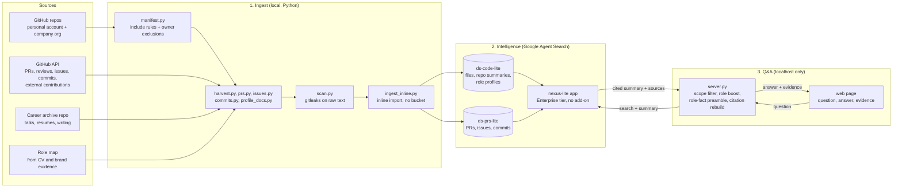
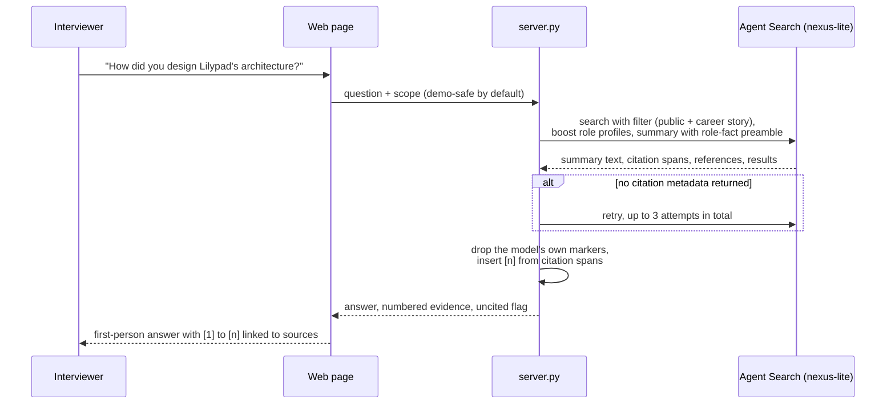
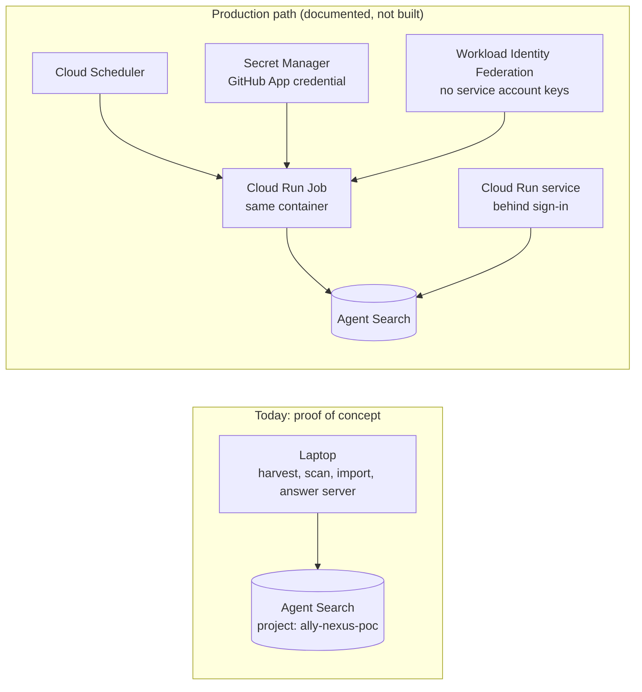

# 00. Architecture

How Nexus turns repositories, issues, talks and writing into cited answers to interview questions, and which part
serves which need.

| Layer | The need it serves |
|---|---|
| 1. Ingest | Every piece of evidence of the work (code, PRs and review threads, issues, commit history, contributions to other organisations' projects, talks, resumes, writing), complete, with no secrets uploaded |
| 2. Intelligence | Answers that know the candidate's role: founding and directing a project is different from writing its code |
| 3. Q&A | Ask what an interviewer would ask; get a first-person answer with a citation on every claim, with no model key |
| 4. Assurance | Every reported number comes from a real API response; any failure stops the run |

## System architecture

The index holds public, private and internal material, so the answer server listens on 127.0.0.1 only.

## What happens when someone asks a question

## Where it runs, and where it would run

## Components and the need each serves

| Layer | Component | Need it serves | Status |
|---|---|---|---|
| Ingest | `nexus/manifest.py` | Complete coverage; owner controls scope (exclusions and fork overrides in gitignored files) | built |
| Ingest | `nexus/harvest.py` | Code and docs as evidence: one document per file, one summary per repo | built |
| Ingest | `nexus/prs.py` | Merged PRs with discussion and review threads | built |
| Ingest | `nexus/issues.py` | Issues for every owned repo including issue-only planning repos; work in other organisations' repos | built |
| Ingest | `nexus/commits.py` | Commit history per repo per month, with authors | built |
| Ingest | `nexus/profile_docs.py` | The owner's role map as citable documents | built |
| Ingest | `nexus/scan.py` | No secrets uploaded: raw-text scan, hold back or redact, re-scan clean | built |
| Ingest | `nexus/ingest_inline.py` | Zero-cost import, resumable, fails on any partial batch | built |
| Intelligence | `nexus/datastores.py` | Permanent store and app settings read back and diffed against spec | built |
| Intelligence | Role facts (profile docs, search boost, summary instruction) | "Led" versus "built" stated correctly | built |
| Intelligence | Project stories (STAR, owner-approved) | Polished narrative answers | not built |
| Intelligence | Drive and Notion, allowlisted folders | The reasoning behind the work | not built |
| Q&A | `nexus/server.py` | Cited answers with no key; demo-safe scope; citation numbers rebuilt from metadata | built |
| Q&A | `web/index.html` | Ask like an interviewer; evidence beside the answer | built |
| Q&A | Hosted version behind sign-in | Share a link without exposing private code | not built |
| Assurance | `nexus/reconcile.py` | Completeness against the harvest and the manifest | built |
| Assurance | `nexus/eval.py` | Retrieval quality on three golden sets | built |
| Assurance | `nexus/answer_smoke.py` | The full question-to-answer chain | built |
| Assurance | Content fidelity check | Stored content matches source at its commit | not built |
